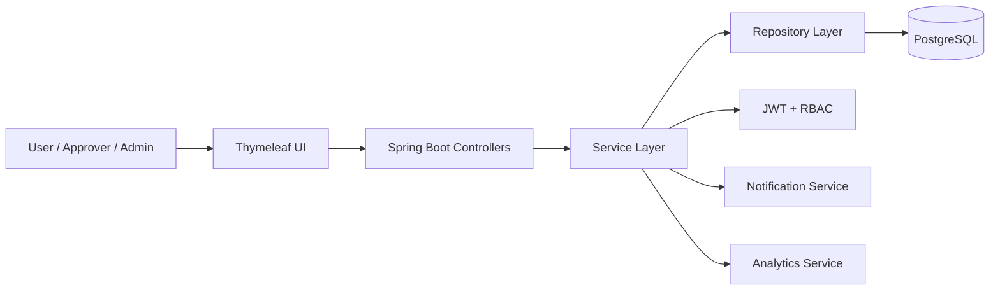
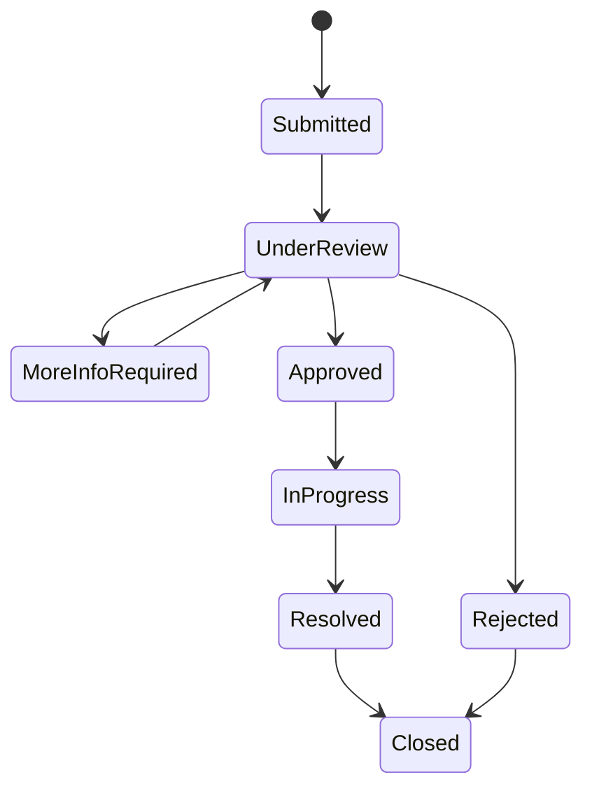
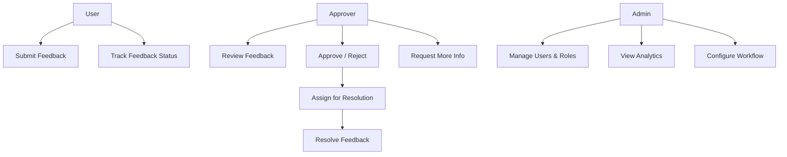
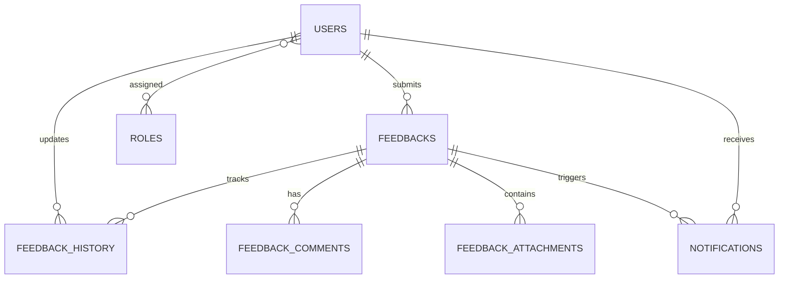

# FeedBloom

Enterprise-style feedback management platform built with Java and Spring Boot.

Designed for structured feedback workflows, approval lifecycle management, analytics, and scalable backend architecture.

---

## Overview

FeedBloom is a backend-focused feedback management system designed to centralize feedback collection, approval workflows, tracking, and reporting across teams and organizations.

The project focuses on:

- Modular backend architecture
- Role-based workflow management
- Feedback lifecycle tracking
- Secure authentication and authorization
- Enterprise-style scalability and maintainability
- Real-time updates and notification workflows

---

## Core Features

### Authentication & Access Control
- JWT-based authentication
- Role-based authorization (User, Approver, Admin)
- Secure session and token handling
- Permission-based workflow access

### Feedback Workflow System
- Feedback submission and tracking
- Approval and review lifecycle
- Comment and status history tracking
- Priority and category management
- Resolution workflow management

### Search & Filtering
- Smart filtering by:
  - Category
  - Priority
  - Status
  - Date range
  - Keywords
- Paginated large dataset handling

### Notifications
- In-app notifications
- Email notification workflows
- Feedback event triggers
- Workflow update alerts

### Analytics & Reporting
- Feedback distribution analysis
- Trending request insights
- Resolution time tracking
- Dashboard-oriented reporting structure

---

## Architecture Focus

This project was designed with emphasis on:

- Layered backend architecture
- Modular service organization
- Scalable workflow handling
- Maintainable code structure
- Enterprise-style backend practices
- Audit/history tracking
- Production-oriented design patterns

---

## Tech Stack

| Category | Technologies |
|---|---|
| Backend | Java, Spring Boot, Hibernate |
| Security | JWT Authentication, RBAC |
| Database | PostgreSQL |
| Frontend | Thymeleaf, JavaScript, jQuery |
| Real-Time & Notifications | AJAX, WebSocket Concepts |
| DevOps & Deployment | Docker |
| Monitoring | Prometheus, Grafana |

---

## Workflow Overview

1. User submits feedback
2. Approver reviews workflow
3. Feedback gets approved/rejected
4. Assigned member resolves issue
5. Timeline/history gets updated
6. Notifications trigger automatically
7. Analytics aggregate workflow data

---

## System Architecture

---

## Feedback Lifecycle

---

## Role-Based Workflow

---

## Security & Reliability

- JWT-based authentication
- Role-based access control
- Rate limiting support
- Audit/history tracking
- Secure workflow handling
- Production-oriented backend structure

---

## System Diagrams

### Flow Chart

---

### UML Sequence Diagram

---

### UML Class Diagram

---

### ER Diagram

---

## Database Design

### Core Database Relationship

---

### Core Entities

| Entity | Purpose |
|---|---|
| users | Authentication and user management |
| feedbacks | Feedback lifecycle management |
| feedback_history | Audit and status tracking |
| feedback_comments | Workflow discussions |
| feedback_attachments | File management |
| notifications | Notification workflows |
| roles / user_roles | RBAC implementation |
| feedback_stats | Aggregated analytics |

---

## Engineering Goals

- Build maintainable enterprise backend systems
- Explore scalable workflow architecture
- Practice structured backend engineering
- Improve observability and workflow reliability
- Design production-oriented backend patterns

---

## Future Improvements

- AI-assisted feedback categorization
- LLM-powered analytics and summarization
- Smart recommendation workflows
- Real-time notification optimization
- Distributed workflow scaling
- API-first architecture improvements

---

## Repository Status

Active and evolving project focused on enterprise backend engineering and workflow-driven system design.
